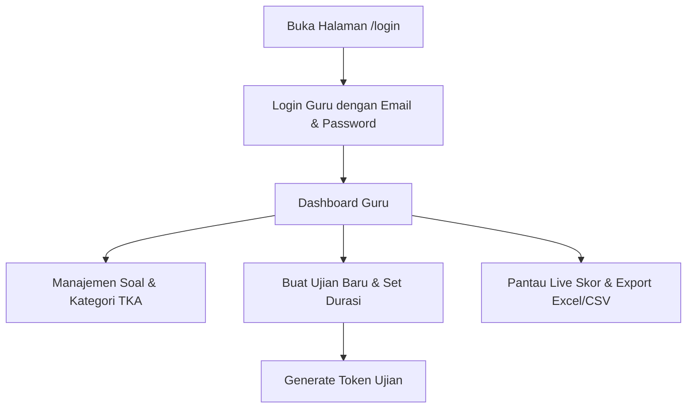
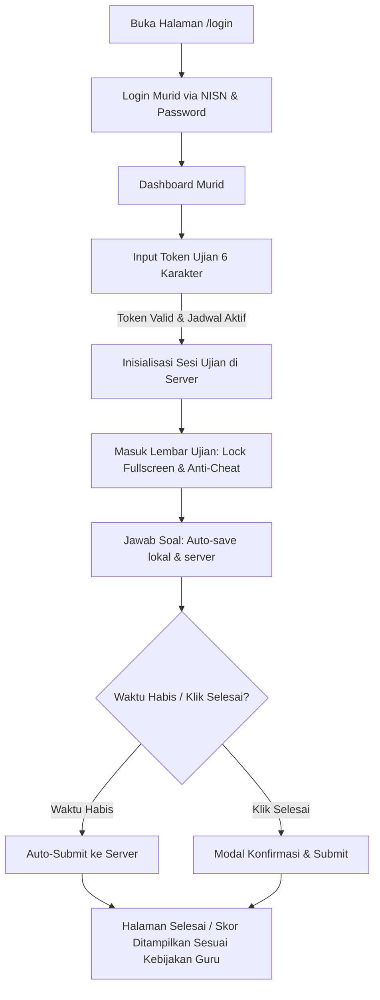

# PRODUCT REQUIREMENT DOCUMENT (PRD)
# SISTEM CBT SIMULASI UJIAN TKA (TES KEMAMPUAN AKADEMIK)
================================================================================
VERSI DOKUMEN: v1.0.0
STATUS: DRAFT INITIAL (MENUNGGU KONFIRMASI)
PENULIS: ZettBOT by Zettbos (System Architect & Mentor)
TANGGAL: 2026-11-02
================================================================================

================================================================================
ZONA ATAS: SPESIFIKASI KEBUTUHAN PRODUK (BLUEPRINT AWAL)
================================================================================

## 1. NAMA PROJEK & PROBLEM STATEMENT
- **Nama Projek:** CBT TKA Master (Computer Based Test - Tes Kemampuan Akademik)
- **Problem Statement:** 
  Pelaksanaan simulasi ujian Tes Kemampuan Akademik (TKA) secara manual atau menggunakan platform kuis standar seringkali mengalami kendala:
  1. Rawan kecurangan (copy-paste, inspect element manipulasi timer).
  2. Beban koreksi manual soal pilihan ganda yang memakan waktu lama.
  3. Ketidakakuratan durasi ujian jika hanya bergantung pada jam perangkat siswa.
  4. Kurangnya analitik instan mengenai rata-rata skor dan sebaran nilai peserta.
- **Solusi:**
  Membangun aplikasi Web CBT berbasis Next.js App Router yang dirancang khusus untuk lingkungan serverless Vercel, didukung cloud database PostgreSQL (Neon/Supabase) dan Prisma ORM. Sistem memiliki validasi waktu terdesentralisasi di server, anti-cheat protektif di frontend, dan manajemen ujian lengkap untuk Guru (Admin).

---

## 2. PERAN PENGGUNA (ROLE-BASED ACCESS CONTROL)
Sistem memiliki 2 peran mutlak:
1. **ADMIN (Guru / Administrator Ujian):**
   - Mengelola akun peserta ujian (CRUD Siswa / NISN).
   - Mengelola Bank Soal TKA (Subtes: Penalaran Matematika, Pemahaman Bacaan & Menulis, Literasi B. Indonesia, Literasi B. Inggris, dll).
   - Mengatur sesi ujian: judul, durasi (menit), jadwal mulai/selesai, serta generate Token Ujian (6 karakter alfanumerik).
   - Memantau live monitoring ujian (siapa yang sedang mengerjakan, sudah submit, sisa waktu).
   - Melihat rekap skor dan ekspor hasil ke Excel/CSV.
2. **STUDENT (Peserta / Murid):**
   - Login menggunakan NISN dan Password.
   - Mengakses Dashboard Siswa, memasukkan Token Ujian yang valid untuk memulai tes.
   - Mengerjakan soal pada Lembar Ujian Interaktif (dilengkapi countdown timer, navigasi nomor warna-warni: Ragu-ragu / Belum / Sudah Terjawab).
   - Fitur Auto-Save jawaban dan Auto-Submit saat waktu server habis.

---

## 3. ARSITEKTUR SISTEM & SPESIFIKASI TEKNOLOGI
- **Architecture Pattern:** Full-Stack Serverless Web Application (Next.js App Router).
- **Frontend:**
  - Next.js 14/15 (React, TypeScript)
  - Styling: Tailwind CSS dengan palet human-crafted Anti-AI (Emerald/Teal `#23A68A`, Slate, Coral Accent) sesuai referensi UI kartu terpisah (split-card).
  - Icons: Lucide React (SVG murni, anti emoji berlebihan).
  - Audio/Alerts: SweetAlert2 / Sonner Toast.
- **Backend:**
  - Next.js Route Handlers & Server Actions.
  - Runtime: Node.js / Edge Compatible di Vercel Serverless Functions.
  - Autentikasi: JWT via HTTP-only Cookies atau Auth.js (NextAuth v5) dengan role payload (`ADMIN` | `STUDENT`).
  - Proteksi Keamanan Serverless: Server-side timer calculation (waktu selesai dihitung dari `startedAt + durationInMinutes`).
- **Database & ORM:**
  - Database: Cloud PostgreSQL (Neon Serverless Postgres / Supabase).
  - ORM: Prisma ORM v5+ dengan Connection Pooling (pgbouncer / Neon pooler) untuk mencegah *connection exhaustion* di Vercel Serverless.
- **Deployment Platform:** Vercel (Auto-CI/CD dari Git).

---

## 4. ALUR KERJA APLIKASI (USER FLOW)

### Alur Guru (Admin):

### Alur Siswa (Peserta):

---

## 5. DESAIN BASIS DATA (SCHEMA PRISMA & RELASI)

### Entitas Inti & Multi-Tipe Soal TKA:
1. `User` (id, identifier/nisn/email, name, password, role: ADMIN|STUDENT, createdAt)
2. `Exam` (id, title, description, code, durationMinutes, token, startTime, endTime, isActive, createdById)
3. `Question` (id, examId, orderNumber, type: SINGLE_CHOICE | COMPLEX_MULTIPLE_CHOICE | TRUE_FALSE, questionText, questionImage, options: Json, correctAnswer: Json, createdAt)
   - **Tipe 1 (Pilihan Ganda):** 4 Opsi (A, B, C, D), 1 jawaban benar.
   - **Tipe 2 (Pilihan Ganda Kompleks):** 3 Opsi centang (non-ABC), 2 benar 1 salah.
   - **Tipe 3 (Benar / Salah):** 3 Pernyataan mandiri, masing-masing memiliki opsi centang Benar atau Salah.
4. `ExamSession` (id, examId, userId, startedAt, submittedAt, expiresAt, status: IN_PROGRESS|SUBMITTED|TIMED_OUT, score, totalCorrect)
5. `Answer` (id, examSessionId, questionId, selectedAnswer: Json, isFlagged: Boolean, updatedAt)

---

## 6. LOGIKA BISNIS & ATURAN VALIDASI KHUSUS

1. **Anti-Manipulasi Timer (Server-Side Authority):**
   - Saat siswa memulai ujian, server mencatat `startedAt = NOW()` dan `expiresAt = NOW() + durationMinutes`.
   - Countdown di frontend hanyalah visual penunjuk waktu.
   - Ketika siswa submit (atau auto-submit), server mencocokkan `NOW()` dengan `expiresAt + gracePeriod` (toleransi lag jaringan 10-15 detik). Jika melewati batas waktu tersebut, server tetap menutup sesi dan menghitung jawaban yang sudah tersimpan.
2. **Pencegahan Kecurangan Dasar (Frontend Guardian):**
   - Disable klik kanan (`contextmenu`).
   - Disable shortcut copy-paste (`Ctrl+C`, `Ctrl+V`, `Ctrl+U`, `F12`).
   - Deteksi kehilangan fokus layar (`blur` / `visibilitychange`). Siswa diberikan peringatan visual jika berpindah tab.
3. **Format Token Ujian & Kode Ujian:**
   - Token Ujian: 6 digit alfanumerik kapital acak unik (contoh: `TKA89X`), dapat di-regenerate oleh guru sewaktu-waktu.
   - Kode Ujian: Mengikuti standar ZettBOT `TKA-YYYYMM-XXX` (contoh: `TKA-202611-001`).

---

## 7. RENCANA ANTARMUKA PENGGUNA (UI/UX)
- **Halaman Login Bersama (`/login`):**
  - Mengadaptasi referensi visual: Split-Card Design.
  - Sisi Kiri: Banner Hijau Zamrud (`#23A68A`) elegan dengan teks branding CBT TKA.
  - Sisi Kanan: Form input modern dengan pemilih peran / switch input (Email Guru vs NISN Siswa), field rounded-pill, dan tombol aksi tanpa reload.
- **Dashboard Guru (`/admin`):**
  - Metrik statistik kompak dalam Grid 3 Kolom (Total Ujian, Siswa Terdaftar, Rata-rata Skor).
  - Tabel ujian aktif dengan pagination server-side dan tombol Copy Token instan.
- **Lembar Ujian Murid (`/exam/[id]`):**
  - Header tetap: Nama ujian, nama siswa, dan countdown timer kontras tinggi.
  - Badan Soal: Panel kiri untuk teks soal & opsi A-E, panel kanan untuk grid navigasi nomor (Kotak 1..N dengan status abu-abu: belum, hijau: sudah, kuning: ragu-ragu).

---

## 8. KRITERIA PENGUJIAN (TESTING CHECKLIST)
- [ ] Guru dapat login dan membuat ujian baru beserta token.
- [ ] Guru dapat input soal pilihan ganda A-E dengan kunci jawaban tersimpan aman (tidak bocor di client-side inspection saat ujian berlangsung).
- [ ] Siswa login via NISN, memasukkan token yang benar, dan masuk ke ruang ujian.
- [ ] Countdown timer menghitung mundur secara akurat, tidak reset saat refresh halaman.
- [ ] Auto-Submit berjalan saat timer menyentuh 00:00:00.
- [ ] Nilai terhitung otomatis di database dan guru dapat mengunduh rekap nilai.

================================================================================
ZONA BAWAH: MASTER CONTEXT & LOGIKA SISTEM TERKINI (LIVING CONTEXT)
================================================================================
- **Status Arsitektur Aktif:** Next.js (App Router) + PostgreSQL (Neon/Supabase) + Prisma ORM + Vercel Serverless.
- **State Autentikasi:** RBAC (ADMIN vs STUDENT) dengan referensi visual Split-Card.
- **Tipe Soal TKA Didukung:**
  1. `SINGLE_CHOICE`: 4 pilihan (A, B, C, D), tepat 1 benar.
  2. `COMPLEX_MULTIPLE_CHOICE`: 3 pilihan centang tanpa huruf abc (2 benar, 1 salah).
  3. `TRUE_FALSE`: 3 pernyataan matriks dengan centang Benar atau Salah per baris.
- **Protokol Keamanan Timer & Kunci Jawaban:** 
  - Server-Validated `expiresAt` dengan LocalStorage backup.
  - Kunci jawaban (`correctAnswer`) tidak pernah dikirim ke frontend klien murid.
- **Log Pembaruan Resmi:**
  - v1.1.0: Integrasi 3 format soal TKA (Pilihan Ganda 4 opsi, Pilihan Ganda Kompleks 3 opsi centang, Benar/Salah 3 pernyataan centang) dan skema penskoran proporsional.
  - v1.0.0: Perumusan arsitektur awal, skema Prisma, dan spesifikasi fitur CBT TKA Vercel-Ready.
